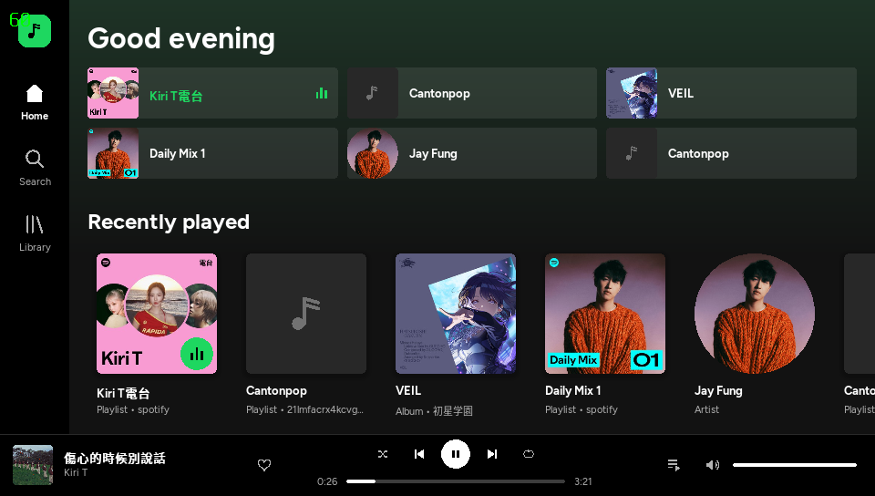
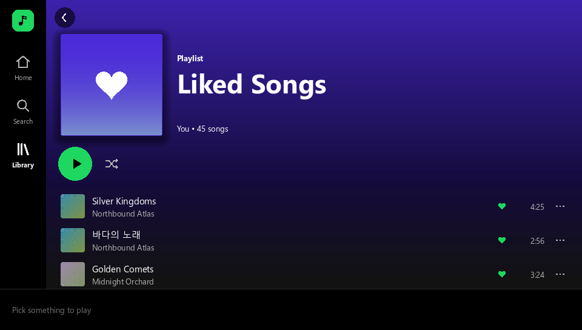
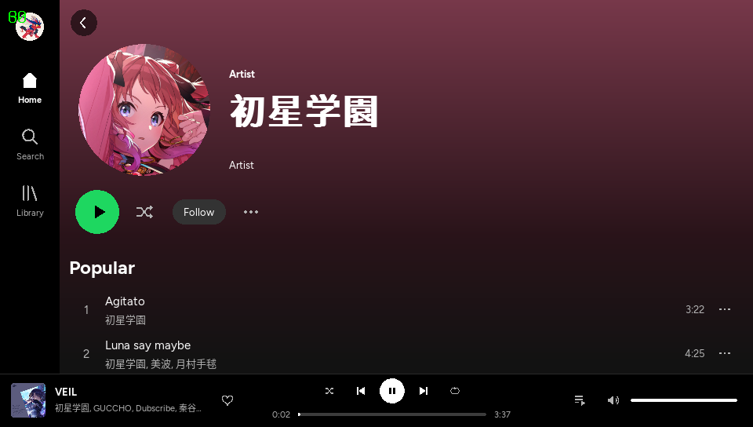

# VitaSpot

A homebrew Spotify client for the PS Vita. It streams and plays music on the
Vita itself through [librespot](https://github.com/librespot-org/librespot),
shows up as a Spotify Connect device in the official apps, and has a touch and
button UI laid out like Spotify's own (sidebar, shelves, Now Playing) with its
own branding. **Spotify Premium is required.**

> Unofficial and not affiliated with Spotify. librespot and the internal
> endpoints used here are Spotify's private protocol, which breaks Spotify's
> Terms of Use. Personal use only.



| Liked Songs | Artist |
|---|---|
|  |  |


## Features

- **Plays on the Vita**: 320 kbps Ogg Vorbis, gapless, seeking from the
  timeline (touch or buttons), volume, shuffle, repeat, queue.
- **Spotify Connect**: the Vita appears in the device list of Spotify on your
  phone or PC; pick it there to sign in or to hand playback over.
- **Browse**: Home (recently played, your playlists, saved albums, your
  artists), Library (Liked Songs, playlists, albums, artists), album, artist
  and playlist pages.
- **Search**: songs, artists, albums and playlists.
- **Your profile**: profile name and picture, playlist owners shown by
  profile name, Spotify-style 2x2 covers for playlists without a picture.
- **Like / save** songs, albums and artists.
- **CJK text**: Chinese, Japanese and Korean titles render through a bundled
  Noto Sans CJK fallback font.

## Installing and signing in

1. Install `VitaSpot.vpk` with VitaShell.
2. Connect the Vita to Wi-Fi and start VitaSpot. It shows a login screen and
   advertises itself as **PS Vita** on your network.
3. Open Spotify on a phone or PC on the **same Wi-Fi**, open the device picker
   (the speaker icon) and choose **PS Vita**. The Vita signs in and remembers
   the account.

If the Vita never appears in the device list, sign in from a PC instead:

```bash
cd backend/librespot-vam
cargo run --release --bin vam-login -- --out credentials.json
```

This opens Spotify's login page in your browser and writes
`credentials.json`. Copy it to the Vita as
`ux0:data/VitaSpot/credentials.json`; VitaSpot picks it up while on the login
screen.


## Controls

### PS Vita

| Input | Action |
|---|---|
| Front touch | Tap, drag or flick to scroll, long-press for the item menu, drag the timeline to seek |
| D-pad | Move focus |
| Left stick | Scroll |
| Cross / Circle | Confirm / back (follows the system's Enter-button setting) |
| Triangle | Play / pause |
| Square | Item menu |
| L / R | Previous / next track |
| Start | Now Playing |
| Select | Queue |

### Desktop

| Key | Vita button | Action |
|---|---|---|
| Arrow keys | D-pad | Move focus |
| Enter / Z | Cross | Activate |
| Esc / Backspace / X | Circle | Back |
| Space | Triangle | Play / pause |
| C / Tab | Square | Item menu |
| Q / E | L / R | Previous / next track |
| N | Start | Now Playing |
| M | Select | Queue |

Mouse: click, drag to scroll, wheel, long-press for the menu.

## How it is built

```
SDL2 frontend (C11, src/)  <-- include/vam_backend.h -->  backend (Rust, backend/librespot-vam/)
                                                            librespot 0.8 + Spotify internal endpoints
```

- **Frontend** (`src/`): an immediate-mode SDL2 UI in C. It never blocks on
  the network; it polls events from the backend once per frame.
- **Contract** (`include/vam_backend.h`): a plain C API (`vam_init`,
  `vam_poll_event`, `vam_request_page`, `vam_play`, ...). Any backend that
  implements it can be linked in.
- **Backend** (`backend/librespot-vam/`): a Rust static library on librespot.
  It handles sign-in, Spotify Connect, audio decoding and output, and builds
  the pages from Spotify's internal endpoints (extended metadata, collection,
  playlist v2, GraphQL search). The public Web API is not used, because it
  rate-limits librespot's shared client id. Details are in
  [backend/librespot-vam/README.md](backend/librespot-vam/README.md).
- **Mock backend** (`backend/mock/`): a fake catalogue for working on the UI
  without an account or network.

### Project layout

| Path | What |
|---|---|
| `include/vam_backend.h` | Contract between UI and backend |
| `src/` | SDL2 frontend (C11) |
| `src/gfx/` | Shapes, icons, text (SDL_ttf + CJK fallback), threaded image loading |
| `src/ui/` | Touch, D-pad focus navigation, momentum scrolling |
| `src/screens/` | Home, Search, Library, detail pages, player bar, Now Playing, menus, login |
| `src/platform/` | Vita and desktop glue, desktop UI scripting (`devscript.c`) |
| `backend/librespot-vam/` | The real backend (Rust) |
| `backend/librespot-vam/vendor/` | Patched copies of librespot and other crates ([why](backend/librespot-vam/vendor/README.md)) |
| `backend/mock/` | Fake backend for UI work |
| `backend/tests/` | Headless contract test for any backend |
| `assets/fonts/` | Bundled fonts (Figtree, Noto Sans CJK) |
| `sce_sys/` | Vita LiveArea images (`tools/gen_livearea.py` regenerates them) |

## Building

### PS Vita VPK

Requirements:

- [VitaSDK](https://vitasdk.org) with `VITASDK` set. Its packages must include
  `sdl2 sdl2_ttf sdl2_image freetype harfbuzz libpng libjpeg-turbo libwebp
  zlib bzip2` (vdpm installs these by default).
- Rust nightly with `rust-src`, because the Vita target builds std from source:

  ```bash
  rustup toolchain install nightly --component rust-src
  ```

Then, from a bash shell (MSYS2 or Git Bash on Windows):

```bash
cd backend/librespot-vam
./scripts/build-vita.sh   # Rust backend -> libvam_backend.a
./scripts/build-vpk.sh    # shim + frontend + link -> build-vita/VitaSpot.vpk
```

`build-vpk.sh` also builds the small POSIX shim in `vita-shim/`. It wraps
`pthread_cond_timedwait`, which Rust's timed waits need on the Vita.

### Desktop with the mock backend

For UI work. It needs a C compiler, CMake, pkg-config, SDL2, SDL2_ttf and
SDL2_image. With MSYS2 (UCRT64 shell):

```bash
pacman -S mingw-w64-ucrt-x86_64-{gcc,cmake,ninja,pkgconf,SDL2,SDL2_ttf,SDL2_image}
cmake -B build -G Ninja
cmake --build build
./build/VitaSpot.exe
```

Mock options: `VAM_MOCK_INSTANT=1` skips login, `VAM_MOCK_FREE=1` simulates a
free account, `VAM_MOCK_STAY_OUT=1` stays on the login screen.

### Desktop with the real backend

```bash
cd backend/librespot-vam && cargo build --release --lib && cd ../..
cmake -B build-real -DVAM_BACKEND=external \
  -DVAM_BACKEND_LIB=$PWD/backend/librespot-vam/target/release/libvam_backend.a \
  -DVAM_BACKEND_LINK_LIBS="-lws2_32 -lbcrypt -lntdll -luserenv -lole32 -loleaut32 -luuid -lwinmm -luser32 -lkernel32 -ladvapi32 -lgdi32 -ldbghelp -lsynchronization -lpropsys -liphlpapi -lpthread -lm"
cmake --build build-real
./build-real/VitaSpot.exe
```

That link list is for Windows. On Linux, `-lpthread -ldl -lm` is usually
enough. The desktop build appears in Spotify Connect the same way the Vita
does.

## Data, logs and troubleshooting

On the Vita everything lives in `ux0:data/VitaSpot/`. On desktop it is SDL's
per-user folder, or the folder named by `VAM_DATA_DIR`.

| File | Purpose |
|---|---|
| `credentials.json` | Saved login |
| `cache/audio/`, `cache/img/` | Audio (200 MB cap) and image (30 MB cap) caches |
| `fonts/` | Optional: fonts here override the bundled ones |
| `recent_searches.txt` | Recent searches |
| `vam.log` | Backend log, rewritten on each start (Vita) |

`vam.log` is the first place to look. It records sign-in, track loads,
seeks, audio underruns, failed Spotify requests and UI frames slower than
45 ms (`slow frame ... ms (events, update+draw, present; text renders, image
uploads)`).

| Symptom | Cause / fix |
|---|---|
| The Vita doesn't appear in the device list | Same Wi-Fi? Some routers block multicast; use the `credentials.json` login above |
| "Search isn't working right now." | Spotify retired the search query hash. `vam.log` shows `PersistedQueryNotFound`; update `SEARCH_HASH` in `backend/librespot-vam/src/search.rs` from a `searchDesktop` request on open.spotify.com |
| "Another Spotify device is controlling playback." | Another device didn't hand over in time; start playback on the Vita again or pick the Vita from that device |
| Audio crackles right after a track starts | Logged as `audio underrun`; the decoder is still filling its buffer |

## Development notes

- **Scripted UI runs (desktop):** `VAM_SCRIPT=script.txt ./build/VitaSpot.exe`
  replays input and saves frames. The commands are `wait`, `key`, `text`,
  `click`, `drag`, `touchdrag` (Vita-style finger events), `shot` and `quit`,
  documented in `src/platform/devscript.c`. Combine with `VAM_MOCK_INSTANT=1`
  to skip login.
- **Contract test:** `backend/tests/` checks any backend against
  `vam_backend.h` headlessly; see its README.
- **Vendored crates:** ten crates (librespot audio, core, connect, discovery,
  oauth, playback, plus rustix, if-addrs, tempfile and ring) carry small Vita
  fixes, such as IPv4-only discovery, Vita paths in temp files and faster track
  loads. Each patch is explained in
  [backend/librespot-vam/vendor/README.md](backend/librespot-vam/vendor/README.md).
- `docs/BACKEND_HANDOFF.md` is the original brief the backend was built from.

## Credits and licences

- [librespot](https://github.com/librespot-org/librespot) (MIT) and the
  other vendored crates under their own licences, recorded in each crate's
  `Cargo.toml`.
- [Figtree](https://github.com/erikdkennedy/figtree) (SIL OFL,
  `assets/fonts/OFL-Figtree.txt`) and
  [Noto Sans CJK](https://github.com/notofonts/noto-cjk) (SIL OFL,
  `assets/fonts/LICENSE-NotoSansCJK.txt`).
- SDL2, SDL2_ttf and SDL2_image (zlib licence), built with VitaSDK.
