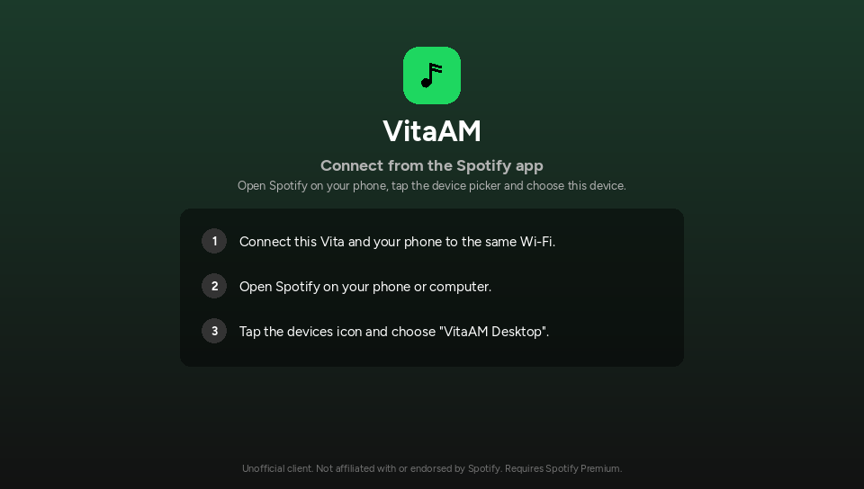

# VitaSpot librespot backend

A Rust static library (`libvam_backend.a`) that implements the C contract in
[`include/vam_backend.h`](../../include/vam_backend.h) on top of
[librespot](https://github.com/librespot-org/librespot) 0.8. It streams Spotify
audio on the PS Vita itself, acts as a Spotify Connect device, and provides the
browsing data the SDL2 frontend renders. Premium accounts only.

The frontend and the header are **not** modified by this crate.

## Status

| Area | State |
|---|---|
| Host build (Windows/MinGW, Linux) | **verified** |
| Host UI integration (desktop SDL2 app, logged-out/zeroconf state) | **verified** |
| Host Zeroconf advertising (mDNS query from another process) | **verified** |
| Contract test against the mock backend | **verified** (499 checks) |
| Contract test against this backend, logged out | **verified** (27 checks) |
| Contract test against this backend, logged in / playback | **unverified** (needs a Spotify Premium account) |
| PS Vita cross-compile + VPK link | **verified** (`armv7-sony-vita-newlibeabihf`, `-Z build-std`) |
| PS Vita runtime (audio, mDNS, suspend/resume, memory) | **unverified** (no hardware access) |

See "Unverified on hardware" at the end for the exact list, and
[`REPORT.md`](REPORT.md) for the full verification log.



## Layout

```
backend/librespot-vam/
  Cargo.toml            crate + [patch.crates-io] for the vendored fixes
  src/abi.rs            #[repr(C)] mirrors of vam_backend.h
  src/ffi.rs            the exported vam_* functions
  src/state.rs          global state, event queue, request cancellation
  src/engine.rs         session/Spirc/player supervision, command handling
  src/internal.rs       Spotify internal endpoints (metadata, collection, playlists)
  src/webapi.rs         session holder + image CDN downloads
  src/search.rs         search via Spotify's GraphQL API (pathfinder)
  src/pages.rs          vam:home / library / search / queue and detail pages
  src/items.rs          Liked Songs entry + small formatting helpers
  src/saved.rs          library snapshot cache + like/save/follow
  src/metadata.rs       track/album/artist metadata cache
  src/images.rs         image download + 30 MB LRU disk cache
  src/platform/         host (rodio) and Vita (sceAudioOut, SceNet) glue
  vendor/               patched crates (see vendor/README.md)
  vita-shim/            tiny POSIX shim needed when linking on the Vita
  scripts/              build-host.sh, build-vita.sh, build-vpk.sh
  tools/vam-login.rs    PC helper that creates a credentials.json
  ../tests/             headless contract test + test README
```

## How it works

* One dedicated `vam-runtime` std thread (1 MiB stack) runs a tokio
  multi-thread runtime (2 workers, 512 KiB stacks). Every network, disk and
  decode operation happens there, never on the UI thread.
* `vam_poll_event()` pops from a `Mutex<VecDeque<vam_event>>`. Page bodies and
  image buffers are allocated by Rust, handed to C, and freed again in
  `vam_event_release()`. `vam_cancel()` either removes a queued reply or marks
  the request so the worker frees its result instead of queueing it.
* The engine owns the librespot `Session`, `Spirc`, `Player` and mixer. A
  100 ms ticker copies `Spirc::snapshot()` (a small extension to
  librespot-connect, see `vendor/`) into `vam_player_state`, only moving
  `position_ms`/`position_timestamp_ms` on discontinuities.
* Page requests are handled by per-request tokio tasks. Browsing uses
  Spotify's internal endpoints (`src/internal.rs`): batched extended metadata,
  collection v2 for Liked Songs / saved albums / followed artists, playlist v2
  for the rootlist and playlists, and recently played for Home. The public Web
  API rate-limits librespot's shared desktop client id (every call returned
  HTTP 429), so nothing uses it. Search goes through the GraphQL API the
  official clients use (`src/search.rs`, persisted query `searchDesktop`).
* Saved state comes from a library snapshot (collection sets + rootlist) that
  is reused for 2 minutes and updated locally on like/save/follow.
* Audio: on the host librespot's rodio/cpal backend is used; on the Vita a
  custom librespot `Sink` writes S16 stereo into a 1-second ring buffer that a
  dedicated thread feeds to `sceAudioOutOutput()` on a BGM port (1024-frame
  grains, 44100 Hz).
* Suspend/resume: a >30 s gap between engine ticks (or an invalidated session)
  triggers a reconnect with the stored credentials; playback comes back
  paused.

## Toolchain

### Host (Windows)

* Rust **stable** for `x86_64-pc-windows-gnu` plus a MinGW-w64 GCC on `PATH`
  (MSYS2 UCRT64, or w64devkit).
* On a minimal MinGW (e.g. w64devkit) that lacks `libgcc_eh.a`, copy
  `libgcc.a` to `libgcc_eh.a` in the toolchain's
  `lib/gcc/x86_64-w64-mingw32/<ver>/` directory. MSYS2's GCC ships it already.

```bash
rustup toolchain install stable-x86_64-pc-windows-gnu
rustup default stable-x86_64-pc-windows-gnu
```

### Host (Linux)

Rust stable and a C toolchain; no extra libraries are needed (rustls + ring
are pure Rust/asm and the webpki root store is bundled).

### PS Vita

1. Install [VitaSDK](https://vitasdk.org), export `VITASDK`.
2. Rust nightly with `rust-src` (the Vita target is tier 3, so std is built
   from source with `-Z build-std`):

```bash
rustup toolchain install nightly --component rust-src
```

## Building on the host

```bash
cd backend/librespot-vam
./scripts/build-host.sh
# -> backend/librespot-vam/target/release/libvam_backend.a
```

(or `cargo build --release --lib`).

### Linking the desktop UI

```bash
cmake -B build -DVAM_BACKEND=external \
  -DVAM_BACKEND_LIB=$PWD/backend/librespot-vam/target/release/libvam_backend.a \
  -DVAM_BACKEND_LINK_LIBS="-lws2_32 -lbcrypt -lntdll -luserenv -lole32 -loleaut32 -luuid -lwinmm -luser32 -lkernel32 -ladvapi32 -lgdi32 -ldbghelp -lsynchronization -lpropsys -liphlpapi -lpthread -lm"
cmake --build build
./build/VitaSpot.exe
```

The `VAM_BACKEND_LINK_LIBS` list is what the Rust static library needs from
Windows. On Linux it is enough to pass `-lpthread -ldl -lm` (add `-lgcc_s
-lutil -lrt` if the linker asks for them).

Without credentials the UI shows its normal login screen with the Zeroconf
instructions; the library is advertising `config.device_name` on the LAN.

## Building for the Vita

```bash
cd backend/librespot-vam
VITASDK=/path/to/vitasdk ./scripts/build-vita.sh
# -> target/armv7-sony-vita-newlibeabihf/release/libvam_backend.a

VITASDK=/path/to/vitasdk ./scripts/build-vpk.sh   # -> build-vita/VitaSpot.vpk
```

`build-vpk.sh` runs the equivalent of:

```bash
arm-vita-eabi-gcc -O2 -c vita-shim/vita_shim.c -o vita_shim.o
arm-vita-eabi-ar rcs libvam_vita_shim.a vita_shim.o
ring_dir=$(dirname $(find target/armv7-sony-vita-newlibeabihf \
             -name libring_core_0_17_14_.a | head -1))

cmake -B build-vita \
  -DCMAKE_TOOLCHAIN_FILE=$VITASDK/share/vita.toolchain.cmake \
  -DVAM_BACKEND=external \
  -DVAM_BACKEND_LIB=$PWD/target/armv7-sony-vita-newlibeabihf/release/libvam_backend.a \
  -DVAM_BACKEND_LINK_LIBS="-Wl,--wrap=pthread_cond_timedwait \
      -L$ring_dir -lring_core_0_17_14_ \
      $PWD/vita-shim/libvam_vita_shim.a -lSceNet_stub -lSceNetCtl_stub -lpthread"
cmake --build build-vita
```

Notes:

* **ring's assembly archive is not inside the Rust `.a`.** ring's build script
  compiles its pregenerated ARM asm into `libring_core_0_17_14_.a`; the final
  link must find it (the script locates it automatically).
* **vita-shim** provides `getppid`, `readlinkat`, `readv/writev`, `dup2` and the
  `*at()` family that Rust std/rustix reference but VitaSDK's newlib does not
  export. None are used at runtime.
* **vita-shim also wraps `pthread_cond_timedwait`** (`-Wl,--wrap=...`). Rust
  std passes `CLOCK_MONOTONIC` deadlines, but VitaSDK's pthread compares them
  with the wall clock, so every timed `Condvar` wait returned at once. That
  made librespot's audio download wait fail and every track was skipped as
  unavailable. Keep the flag if you link the VPK by hand.
* The resulting VPK is ~25 MB (24,925,319 bytes with this toolchain);
  `eboot.bin` is ~11.3 MB.

## Logging in (Premium account required)

### Primary path: Spotify Connect / Zeroconf

The backend advertises `config.device_name` (e.g. "VitaSpot Desktop" or the
`PS Vita` name from the frontend) over mDNS while `vam_auth_state.status` is
`LOGGED_OUT`. Open Spotify on a phone/PC on the same Wi-Fi, tap the device
picker and select the device. The phone sends a credentials blob, the backend
stores it in `<data_dir>/credentials.json` and signs in.

`zeroconf_active` is 1 while the device is advertised. On later launches the
stored credentials are used automatically.

The backend calls `SceNetCtlGetState` and reports "Wi-Fi is off..." through
`vam_auth_state.message` instead of hanging when there is no connection.

### Fallback: copy a credentials file from a PC

mDNS multicast on the Vita network stack is plausible but **unverified on
hardware**. If the device never shows up in the phone app, or you want a
deterministic login, generate a librespot credentials file on a PC:

```bash
cd backend/librespot-vam
cargo run --release --bin vam-login -- --out credentials.json
# opens the Spotify login page in your browser, then writes credentials.json
```

Copy that file to the Vita as `ux0:data/VitaSpot/credentials.json` and launch
VitaSpot. The backend watches for the file while logged out and signs in as soon
as it appears. It also prints the fallback instructions in the login screen's
message when Zeroconf cannot be started.

Stock librespot's own `credentials.json` (from `librespot --cache ...`) works
as well. `vam_login_url` / `vam_login_code` are currently not offered, because
Spotify's OAuth redirect needs a browser on the same machine as the redirect
listener.

## Data directory

`config.data_dir` (the frontend passes SDL's pref path on desktop and
`ux0:data/VitaSpot/` on the Vita) contains:

| Path | Purpose |
|---|---|
| `credentials.json` | reusable librespot credentials |
| `volume` | last volume (librespot cache) |
| `cache/audio/` | librespot audio cache, size-capped at 200 MB |
| `cache/img/` | image cache used by `vam_request_image`, capped at 30 MB |
| `tmp/` | temporary files used by librespot while streaming |
| `vam.log` | Vita only: backend log (truncated on each start) |

`vam_logout()` deletes the credentials file, stops playback, releases the
session and returns to `LOGGED_OUT`, with Zeroconf advertising again.

## Contract test

`backend/tests/contract_test.c` is a headless driver for the whole C API. See
[`backend/tests/README.md`](../tests/README.md). It runs against the mock
(499 assertions, fully green) and against this backend (auth/event/id/cancel
invariants while logged out; the playback part needs credentials).

## Vendored librespot fixes

Ten crates are patched locally (librespot-audio, librespot-core, librespot-connect,
librespot-discovery, librespot-oauth, librespot-playback, rustix, if-addrs, tempfile and ring) - all changes are documented in
[`vendor/README.md`](vendor/README.md). The two most important ones:

* librespot-core no longer calls `process::exit(1)` for non-Premium accounts;
  VitaSpot reports `is_premium = 0` and the UI shows its Premium screen.
* librespot-connect gained a read-only `Spirc::snapshot()` and a local
  `add_to_queue`, because the contract needs the current track, queue,
  context title and active-device flag.

## Known limitations / unverified on hardware

* **No real Spotify account was available while developing this.** The login
  handshake, streaming, Connect control, browse pages, saving and seek/pause
  behaviour are implemented and type-checked, but not exercised against
  Spotify's servers. Treat everything audio/content related as unverified.
* **Vita Zeroconf/mDNS** is implemented (libmdns + an interface list from
  `SceNetCtl`) but has not been tested on hardware. The credentials-file
  fallback exists for that reason.
* **Vita audio output** uses `sceAudioOutOpenPort(BGM, 1024, 44100, stereo)`
  and a 1 s ring buffer; latency and behaviour after suspend/resume are
  unverified.
* **Suspend/resume** reconnects when the session dies or a >30 s tick gap is
  seen; the actual Vita suspend behaviour has not been observed.
* **Memory/CPU**: the release VPK's `eboot.bin` is ~11 MB, much of it Rust
  std/librespot code. Resident memory is expected to be dominated by decoding
  buffers and TLS state, but it was not measured on a Vita.
* Podcasts (`spotify:show:`) return `VAM_ERR_UNSUPPORTED`; the frontend has no
  podcast UI yet.
* `vam_login_url` / `vam_login_code` are left empty (no OAuth web flow).
* The `VAM_EV_*` event order matches the mock; minor differences are noted in
  the hand-off report (none affect the header contract).

## Differences from the mock backend

Where the header is silent and the mock was the reference:

* `vam:home` shows live data instead of fixed fake shelves: recently played
  contexts, your playlists, saved albums and followed artists ("Your
  artists"; Spotify's internal endpoints have no top-artists list). The grid
  layout and section order match the mock.
* `is_saved` comes from the cached library snapshot, so changes made on
  another device show up within 2 minutes.
* Artist page subtitles are "Artist": follower counts are not part of the
  internal artist metadata.
* Following or unfollowing playlists returns `VAM_ERR_UNSUPPORTED`; it needs
  rootlist changes that are not implemented.
* Search relies on the persisted-query hash for `searchDesktop` in
  `src/search.rs`. If Spotify retires it, search fails with "Search isn't
  working right now." and vam.log shows `PersistedQueryNotFound`; the hash
  then needs updating.
* `vam_play()` activates the Vita locally (`Spirc::activate`) before loading;
  a transfer (`Spirc::transfer`) is only used by resume/next/prev/seek/queue
  while another device is active. The mock has no equivalent.
